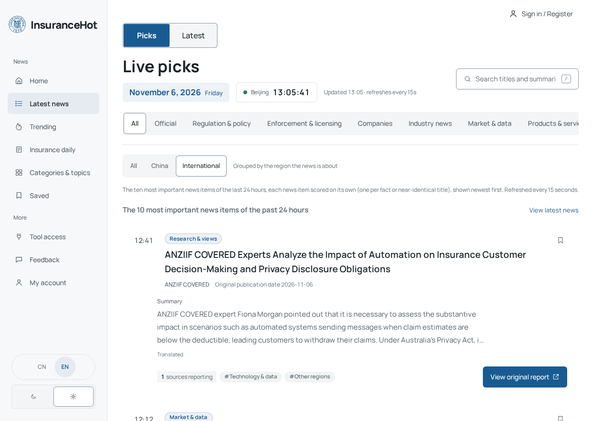
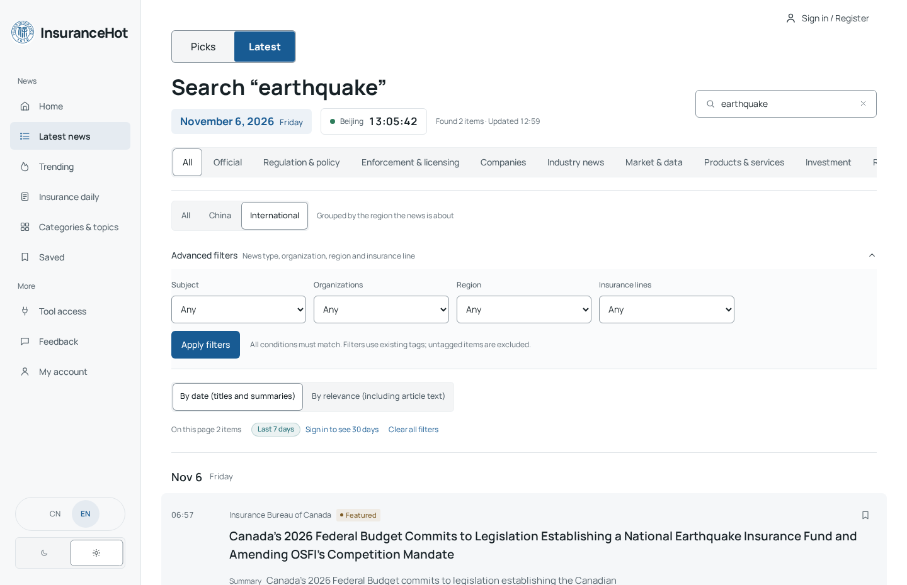
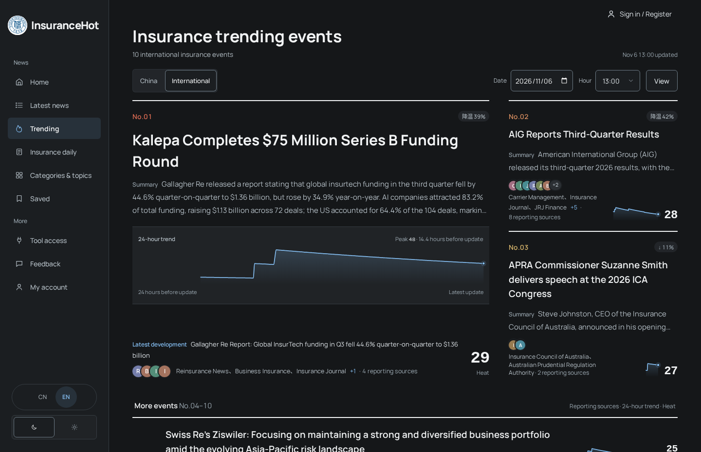
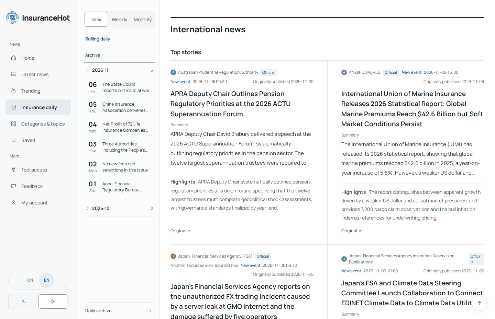
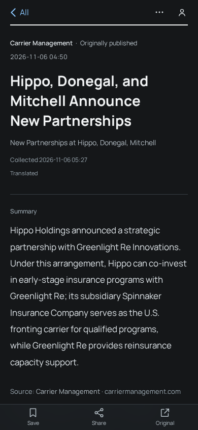

[简体中文](README.md) · **English**

<p align="center">
  
</p>

<p align="center"><strong>Insurance news, from first report to follow-up.</strong></p>

InsuranceHot is a news desk for insurance professionals, researchers, and industry readers. Browse regulatory announcements, company disclosures, and trade coverage in one place. Use live picks and trending events to decide what to follow, then turn to timelines, briefings, and original sources for the full story.

<p align="center">
  <strong>
    <a href="#product-showcase">Product showcase</a> ·
    <a href="#reader-guide">Reader guide</a> ·
    <a href="#getting-started">Getting started</a>
  </strong>
</p>

## Promo video

https://github.com/user-attachments/assets/0bf97c5d-ccb3-43ff-9e3a-863bd908fbde

## Product showcase

<picture>
  <source media="(prefers-color-scheme: dark)" srcset="docs/assets/readme/en/featured-dark.png">
  
</picture>

*Live picks shows recent international headlines alongside their sources. Captured on the running site on November 6, 2026.*

## Reader guide

### 01 · Catch up on the latest news

On **Home**, choose **Today’s highlights**, or open **Latest news** from the navigation. The **Picks** tab covers the most important stories of the past 24 hours. Start with **Summary** and **Why it matters**, then open the reporting that interests you. Switch to **Latest** to browse collected articles by date. You can page through the feed or jump to a page. At the bottom of **Picks**, choose a date and time to review the preceding 24 hours.

Choose **Official** for primary-source releases, or browse desks such as **Regulation & policy**, **Companies**, and **Market & data**. Switch between **China** and **International** according to the market the story covers.

### 02 · Narrow the feed with search and directories

Use the search box in the news feed. Choose time order to search titles and summaries, or relevance to include full text. Open **Advanced filters** to combine topics, organizations, regions, and insurance lines. For example, select **Regulation & policy**, then narrow the feed by organization or insurance line.

In **Categories & topics**, browse directories for **Categories**, **Organizations**, **Topics**, and **Insurance lines**. Organization pages let you switch between all coverage and picks to see how a story fits into that organization's timeline.



### 03 · Follow trending events back to their sources

Open **Trending** and switch between **China** and **International** to see ranked events, changes in activity, reporting sources, and 24-hour charts where available. To revisit a past ranking, select a date and hour, then choose **View**.

Open an event to compare coverage in its background, developments, and reporting timeline. Change the timeline order or show official or featured reports only. Article pages show the publisher and original publication date, with the time the article was added listed separately. Use **Open original** to check the publisher's page. Automated summaries, explanations, and event overviews help you scan the coverage. Consult the original for anything you cite. Use the article’s action menu to copy its link or export it as Markdown.



[View an event detail screenshot](docs/assets/readme/en/story-dark.png)

### 04 · Read the daily, weekly, and monthly editions

Open **Insurance daily** for the **Rolling daily**, or select a finalized issue from the **Archive**. The daily separates China and international coverage and shows the reporting window, last update, and edition status. Follow any story to its reports and original sources.

Use the **Weekly** and **Monthly** tabs to review a period's developments by section. The daily archive lets you find older issues by date.



### 05 · Save stories and make the site your own

Select the bookmark icon next to a story, then find it under **Saved**. Guest bookmarks stay in the current browser and can be backed up or restored from a file. Sign in to sync bookmarks, read status, preferences, and follows across devices. You can also merge earlier bookmarks from the current browser into your account.

Use **My account** to manage your account or change reading preferences. The site offers a Chinese and English interface, light and dark themes, and font options. Use **Feedback** to report a problem or request a source correction, with a screenshot if helpful.

<details>
<summary>View a mobile article page</summary>



</details>

### 06 · Read InsuranceHot in your own tools

In **Tool access**, choose the integration you need. **RSS feeds** bring picks, the full news feed, and daily, weekly, and monthly editions into a feed reader. **REST API** and **MCP** offer read-only access to news, events, and reports. All three require you to sign in and create an **API Key**.

**One-step setup** provides a prompt that a command-capable assistant can follow to configure MCP and Skill access and run a test query. The personal WeChat page walks you through connecting ClawBot. Sign in and scan the QR code to authorize news queries and scheduled picks in WeChat.

## Getting started

### Read in a browser

Open the site address supplied by your deployment operator. Go to **Latest news → Picks** for recent headlines, or open **Insurance daily** for the current issue. These reading views are available to guests. Sign in when you want to sync across devices.

### Run a local preview

This repository contains the reader guide and showcase assets. The commands below are for maintainers who already have an authorized checkout of the application source. Run them from its root.

**Docker preview** requires Node.js 24.22.1 or a later 24.x release, Docker Engine, and Docker Compose. Compose provides PostgreSQL 17. Initialize the environment in a fresh source checkout.

```bash
node scripts/init-env.ts
```

Keep the admin password, session secret, and image signing secret generated in `.env`. Use the following settings for the preview.

```dotenv
SITE_URL=http://localhost:3000
COLLECT_ENABLED=false
MODEL_CALLS_ENABLED=false
```

```bash
docker compose up -d --build db api web
```

Once the services are up, visit [localhost:3000](http://localhost:3000). The first startup initializes the database. The site may start with an empty feed.

<details>
<summary>Start the development environment with npm</summary>

Use Node.js 24.22.1 or a later 24.x release, npm, and PostgreSQL 17. Initialize `.env` as above and use a local database role with permission to create a database. Make sure ports 3000 and 3001 are available.

```bash
npm ci
createdb insurhot_dev
```

Set the connection addresses in `.env` and adapt the example connection string to your database authentication.

```dotenv
DATABASE_URL=postgres://localhost:5432/insurhot_dev
API_BASE_URL=http://127.0.0.1:3001
```

```bash
npm run db:migrate
```

Run `npm run dev:api` and `npm run dev:web` in separate terminals. Run `npm run build -w @aihot/web` to build the web release.

</details>

The basic preview needs a database and the generated application secrets. To enable model processing, configure `LLM_BASE_URL`, `LLM_API_KEY`, and `LLM_MODEL` using the authorized checkout's `.env.example`. Email verification requires `SMTP_*` settings. Enable other external services as needed. Keep credentials in your local `.env`. For production, see `docs/server-deployment.md` and `deploy/server.compose.yml` in the authorized source checkout.

[Screenshot provenance and refresh notes](docs/assets/readme/README.md)
