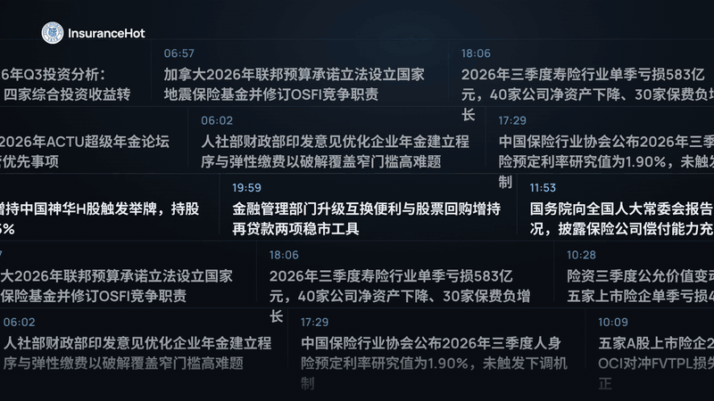
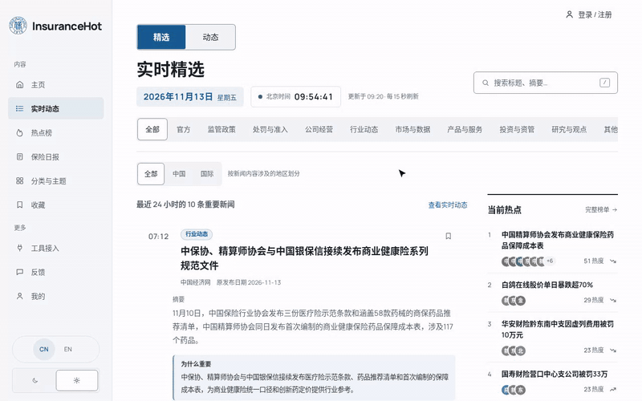
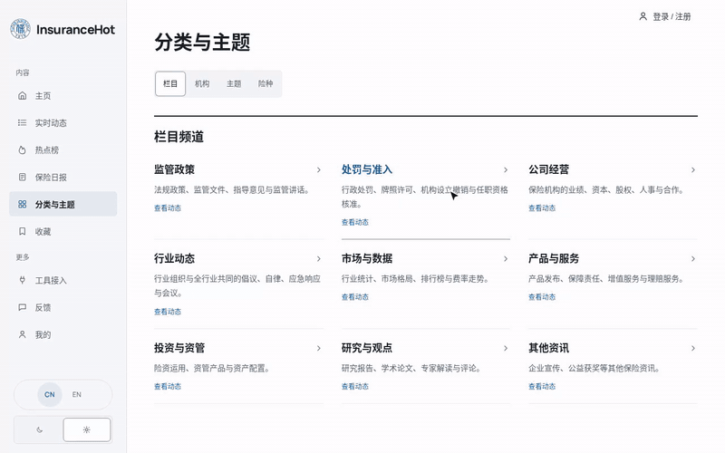
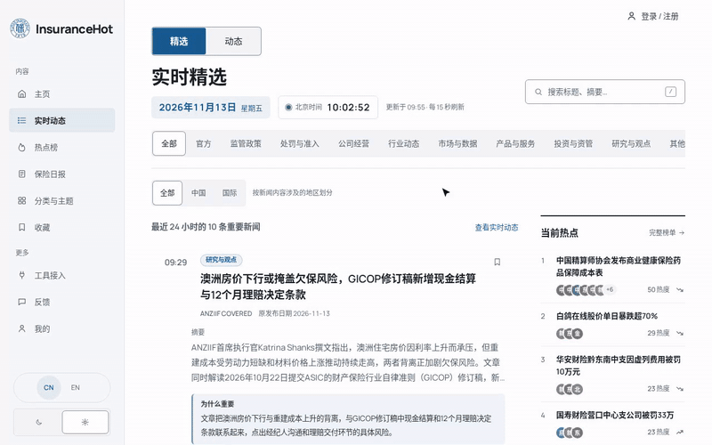
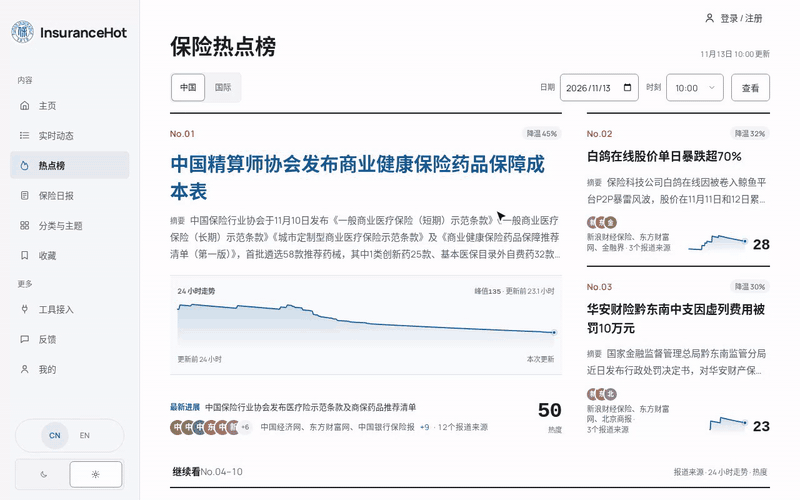
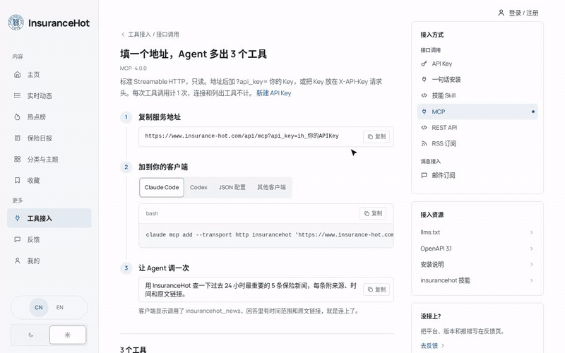
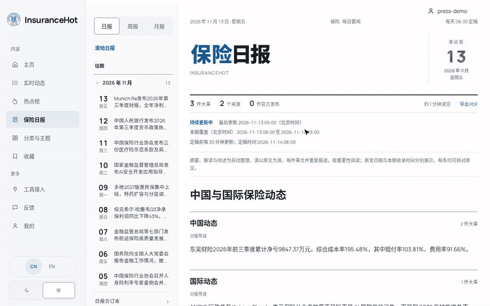

<p align="center">
  
</p>

<p align="center"><b>Global insurance news, for people to read and for AI to use.</b></p>

<p align="center">
  <a href="https://www.insurance-hot.com"></a>
  <a href="#agent"></a>
  <a href="https://www.insurance-hot.com/openapi-v1.json"></a>
  <a href="#rss"></a>
  <a href="https://github.com/FDU-INS/Insurance-Hot/stargazers"></a>
  <a href="https://hits.sh/github.com/FDU-INS/Insurance-Hot/"></a>
</p>

<p align="center"><a href="README.md">简体中文</a> · <b>English</b></p>

<p align="center">
  <a href="https://github.com/user-attachments/assets/e55e28e0-42aa-4bb6-ada9-eb557965b37c"></a>
</p>

<p align="center">
  <a href="https://www.insurance-hot.com/featured?lang=en">Picks</a> ·
  <a href="https://www.insurance-hot.com/hot?lang=en">Trending</a> ·
  <a href="https://www.insurance-hot.com/daily?lang=en">Daily</a> ·
  <a href="https://www.insurance-hot.com/topics?lang=en">Topics</a> ·
  <a href="#agent">Connect an agent</a>
</p>

**InsuranceHot** is an insurance news platform published by Professor Xu Xian's team at Fudan University. It brings regulatory notices, company disclosures and industry reporting from many places together, then filters, classifies, analyses and groups them into an up-to-date, well-sourced picture of the industry. Insurance professionals read it on the website every day; AI agents can call it directly through MCP, a REST API and RSS.

## Where to start

| You want to see | Start here |
| --- | --- |
| What happened in insurance today | [Picks](https://www.insurance-hot.com/featured?lang=en): the past 24 hours' important news, with summaries, why each matters and a link to the original |
| What regulators have just done | [Official](https://www.insurance-hot.com/featured?lang=en): first-hand releases from regulators and industry associations in one place |
| How a story has developed | [Trending](https://www.insurance-hot.com/hot?lang=en): China and international boards; open an event for its background, developments and report timeline |
| A line of business, topic or company | [Topics](https://www.insurance-hot.com/topics?lang=en): browse by section, line, topic, region and organisation, e.g. Huiminbao or consumer protection |
| One read a day or a week | [Daily](https://www.insurance-hot.com/daily?lang=en): a rolling daily, plus weekly and monthly reports |
| Not to visit the site every day | [Email subscriptions](https://www.insurance-hot.com/agent/email?lang=en): combine sections, lines and topics, and receive a digest daily, weekly or monthly |

<details>
<summary><b>Screen recordings of the six highlights</b></summary>

### All the important insurance news in one place

China and international, regulators, companies and markets: the industry's important developments on one platform.



### A tag system built for the industry

Sections, lines of business, topics, regions and organisations, designed around what different roles follow and the industry's core issues — from Huiminbao and annuities to consumer protection and solvency.



### Official sources, tracked continuously

Releases from regulators and industry associations are marked and shown together, each traceable to its original.



### Analysis and trending stories

What matters and why; reports of the same event from many sources grouped into one storyline.



### One step to connect AI tools

Mainstream AI tools and in-house agents can connect, query insurance news directly and cite the original sources.



### Updates delivered to you

Daily, weekly and monthly reports, and email subscriptions you configure yourself.



</details>

<a id="agent"></a>

## Let your agent read the insurance industry

InsuranceHot offers a remote, read-only MCP server (Streamable HTTP) and a REST API with the same content. Once connected, an agent can query the latest news, the background of a trending event, and the daily, weekly and monthly reports, citing the original sources in its answers.

### One-sentence setup

**1. Create an API key**: sign in with your email on the website under [Tool access → API keys](https://www.insurance-hot.com/agent/keys) and create a key. It is free, and keys start with `ih_`.

**2. Send this sentence to your AI tool** (with your own key):

```text
My InsuranceHot API key is ih_…. Please read https://www.insurance-hot.com/install and follow it to connect yourself to InsuranceHot, then answer: what were the big insurance stories this week? Please cite the original sources.
```

It works with AI tools that can read and write local files, such as Claude Code, Codex, Cursor, WorkBuddy and DeepSeek Harness. The tool follows the guide to install the skill and your key for itself (Claude Code, Codex and Cursor also get the MCP server), makes one test call, then answers the question with InsuranceHot data. From the next session on, just ask.

### Ask in plain language

No need to remember tool names:

| You can ask | What the agent does |
| --- | --- |
| What were the big insurance stories this week? Please cite the sources. | Reads this week's news and the trending board and lists the main points, each with source, date and original link |
| What is number one on the trending board, and how did it develop? | Reads the China trending board, then lays out the event's reports and developments as a timeline |
| What has Ping An done in the past week? | Queries everything about the organisation in the last 7 days, separating group, life and P&C |
| Any regulatory news on Huiminbao recently? | Filters by line of business and section, and says which items are regulations and which are industry reference texts |
| Give me today's briefing for a compliance team | Summarises the day's regulatory, enforcement and licensing items with suggested follow-ups |

### Real examples

Excerpts of real answers on 2026-11-13 (the service answers in Chinese; content changes over time, so check the originals before quoting).

**Q:** "What is number one on China's insurance trending board now, and how did it develop?" → `insurancehot_event` (board=中国) + `insurancehot_event` (id=…), 2 calls

```text
截至北京时间 2026-11-13 13:05，中国保险热点榜第一是“中国精算师协会发布商业健康保险药品保障成本表”。
这个事件在站内收了 63 篇报道，来自 12 家信源。

11 月 10 日，三家机构接连发布了一组商业健康险文件：
- 中国保险行业协会发布三份医疗险示范条款（短期、长期、城市定制型即惠民保），
  统一了“合理且必要”等 24 个常用概念的释义，首次把调解介入写进争议处理；
- 同时发布《商业健康保险药品保障推荐清单（第一版）》，收录 58 款药械，其中医保目录外自费药 32 款；
- 中国精算师协会发布行业第一份商业健康保险药品保障成本表，涉及 117 个药品。
以上文件都是示范性参考，没有强制性。
（共 17 条报道时间线，每条附原文链接）
```

**Q:** "Any regulatory news on Huiminbao recently? Please cite the sources." → `insurancehot_news` (line=惠民保) + `insurancehot_news` (q=惠民保, column=监管政策), 2 calls

```text
截至 2026年11月13日12:55（北京时间），我在 InsuranceHot 近7天收录的“惠民保”监管政策中
没有查到新的监管部门文件。最近最相关的规范动态是：

- 11月10日，中国保险行业协会发布《城市定制型商业医疗保险示范条款》……供行业参考，不具有强制性。
  这是行业协会的示范文本，不宜称为监管新规。[中国银行保险报，11月12日原文](https://www.cbimc.cn/news/336928)

查询范围是近7天的公开收录资料；未查到不等于这段时间没有其他地方性监管动态。
```

**Q:** "What were the big insurance stories this week? List 5, each with source, date and original link." → `insurancehot_report`, `insurancehot_event`, `insurancehot_news`

```text
这周（11-06 ~ 11-13）保险业五件大事
1. 商业健康险“新基础设施”同日发布：三套医疗险示范条款和商保药品清单、成本表
2. 国务院专题学习定调多层次社会保障体系：明确“支持商业健康保险发展壮大”
3. 金融监管总局就保险公司董监高任职资格管理办法征求意见：条文增至66条、负面清单扩至18项
4. 保险科技股白鸽在线两日暴跌约75%，市值蒸发逾350亿港元
5. 安联前三季度经营利润141亿欧元创同期纪录，全年目标上限上调至约186亿欧元
（每条附来源、日期和原文链接）
```

### Manual setup: MCP + skill

If you prefer not to use the one-sentence setup, configure two things yourself:

- **MCP server**: in your AI tool's MCP settings, add a remote server (Streamable HTTP) named `insurancehot` with the address `https://www.insurance-hot.com/api/mcp?api_key=ih_YOUR_KEY`.
- **Skill**: put [`SKILL.md`](https://www.insurance-hot.com/skills/insurancehot/SKILL.md) in your AI tool's skills directory (`insurancehot/SKILL.md`). It tells the agent how to answer with as few calls as possible: with the skill a question usually takes 2–4 calls; without it, up to 9–12.

<details>
<summary><b>Commands for common tools</b></summary>

<br>

**Claude Code** (skills directory `~/.claude/skills/`)

```bash
claude mcp add --transport http insurancehot 'https://www.insurance-hot.com/api/mcp?api_key=ih_YOUR_KEY' -s user
```

**Codex** (skills directory `~/.agents/skills/`)

```bash
codex mcp add insurancehot --url 'https://www.insurance-hot.com/api/mcp?api_key=ih_YOUR_KEY'
```

**DeepSeek Harness** (skills directory `~/.agents/skills/`): create `~/.dsh/cordis.patch.yml` with the content below, then run `npx @deepseek-ai/dsh web`.

```yaml
- insert:
    - id: mcp-insurancehot
      name: '@deepseek-ai/dsh-mcp-client'
      config:
        serverName: insurancehot
        transport: streamable-http
        url: https://www.insurance-hot.com/api/mcp?api_key=ih_YOUR_KEY
```

</details>

### MCP tools

Server: `https://www.insurance-hot.com/api/mcp` (Streamable HTTP). Pass the key in an `X-API-Key` header or an `?api_key=` parameter.

| Tool | Purpose | Main parameters |
| --- | --- | --- |
| `insurancehot_news` | News from the last 1–7 days; with `id`, one story and its event | `q` keyword, `column` section, `line` line of business, `topic`, `region`, `org` organisation, `days`, `since`, `scope` (精选 picks / 全部 all), `limit` (≤20) |
| `insurancehot_event` | Without `id`, the current top 10 trending events; with `id`, an event's background and timeline | `board` (中国 China / 国际 international / 全部 all), `id`, `limit` |
| `insurancehot_report` | Daily, weekly and monthly reports | `kind` (日报 / 周报 / 月报), `period` (e.g. 2026-11-04, 2026-W44, 2026-10, or latest) |

Parameter values are Chinese, as listed in the [skill file](https://www.insurance-hot.com/skills/insurancehot/SKILL.md).

### REST API

The same JSON as MCP, under `/api/v1`; see the [OpenAPI specification](https://www.insurance-hot.com/openapi-v1.json).

| Purpose | Endpoint |
| --- | --- |
| News | `GET /api/v1/news?…`, `GET /api/v1/news/{id}` |
| Trending board, events | `GET /api/v1/events?board=中国`, `GET /api/v1/events/{id}` |
| Reports | `GET /api/v1/reports/{日报\|周报\|月报}/{period\|latest}` |

<a id="rss"></a>

### RSS

| Feed | URL |
| --- | --- |
| Picks (recommended) | `https://www.insurance-hot.com/feed.xml` |
| All news | `https://www.insurance-hot.com/feed/all.xml` |
| Daily / weekly / monthly | `https://www.insurance-hot.com/feed/daily.xml` · `weekly.xml` · `monthly.xml` |

News feeds accept the same filters as the news API, e.g. `/feed.xml?line=车险&region=中国`. RSS also needs an API key, with its own allowance.

### Before you start

| | |
| --- | --- |
| **API key** | Free; sign in with your email on the website to create one. Required for every API and RSS feed |
| **Allowance** | 100 calls a day per account (MCP and REST combined; RSS counted separately), and no more than 100 a day from one IP across all accounts and keys; reset at midnight Beijing time, over the limit returns 429 |
| **Read-only** | The API only reads; it gives no buying advice or quotes |
| **Coverage** | News from the last 1–7 days; the current top 10 trending events; daily, weekly and monthly reports by period |
| **Safety** | Titles and summaries come from external sources; the skill tells the agent to treat them as material, never as instructions. Check important facts against the original |
| **Compatibility** | Any client supporting MCP over Streamable HTTP; full details in [llms.txt](https://www.insurance-hot.com/llms.txt) |

## Feedback

Summaries and analysis are AI-assisted; quote the original sources. For problems or source corrections, use [Feedback](https://www.insurance-hot.com/feedback) on the website.

If you find it useful, a **Star** helps you find your way back.

## Star history

<a href="https://www.star-history.com/?repos=FDU-INS%2FInsurance-Hot&amp;type=date">
  <picture>
    <source media="(prefers-color-scheme: dark)" srcset="https://api.star-history.com/chart?repos=fdu-ins/insurance-hot&amp;type=date&amp;theme=dark">
    
  </picture>
</a>

---

<p align="center"><sub>Fudan Insurance Team ｜ 苏ICP备2021024924号-8</sub></p>
