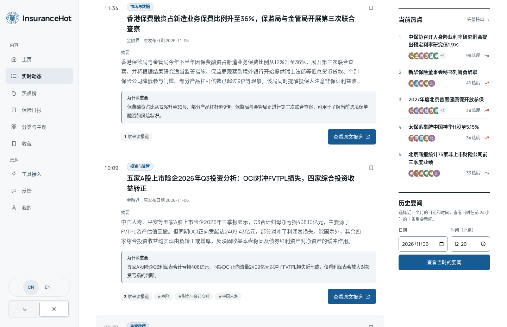
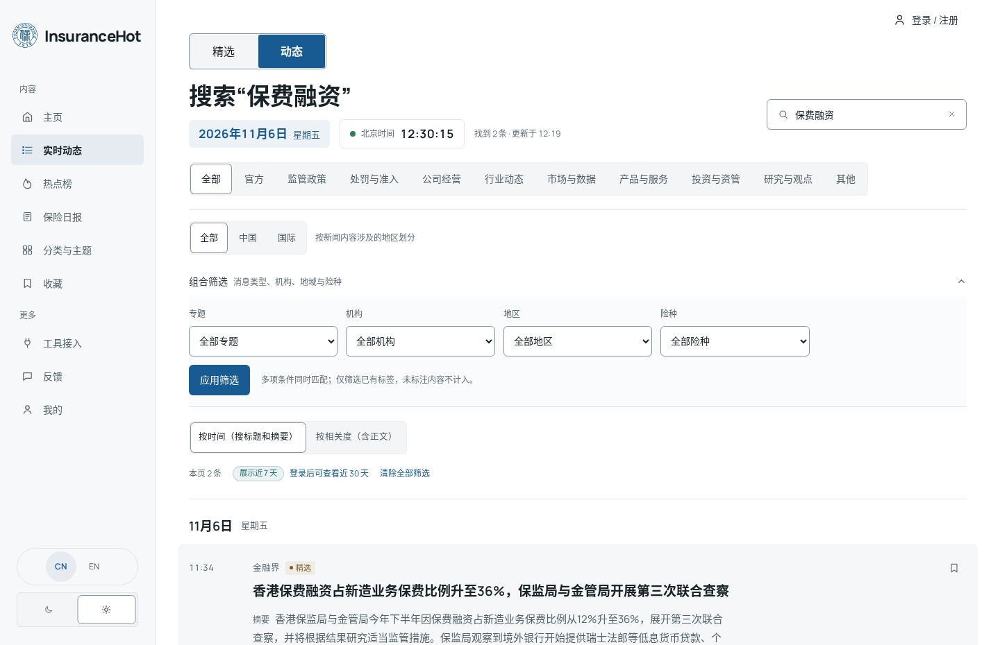
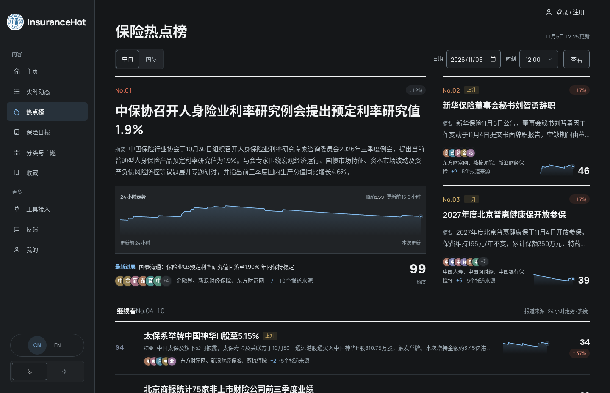
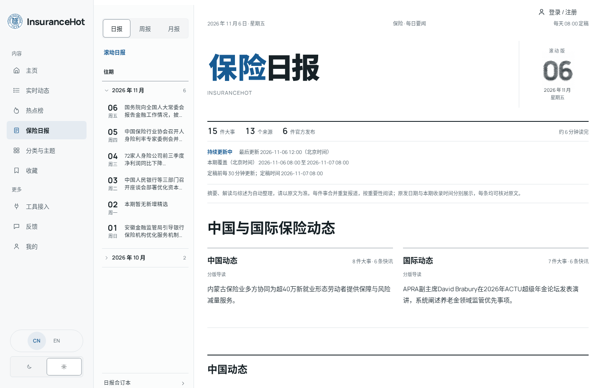
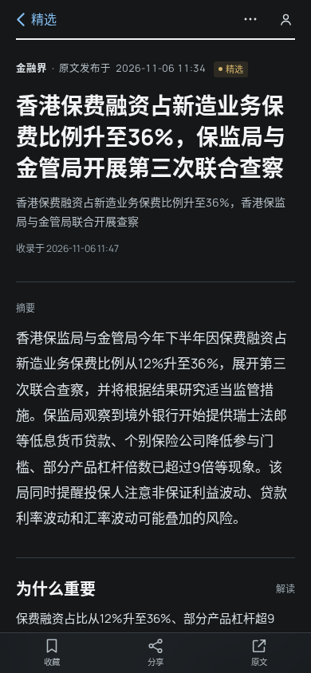

**简体中文** · [English](README.en.md)


# InsuranceHot

**Insurance news, from first report to follow-up.**

面向保险从业者、研究者和行业读者的资讯平台。在一个入口浏览监管公告、机构披露和行业报道，从实时精选和热点榜找到值得跟进的事，再沿事件时间线、日报和原文查清来龙去脉。

[产品一览](#产品一览) · [使用指南](#使用指南) · [快速开始](#快速开始)

## 产品一览

<picture>
  <source media="(prefers-color-scheme: dark)" srcset="docs/assets/readme/featured-dark.png">
  
</picture>

*实时精选把近期要闻、报道出处和当前热点放在同一页。图为 2026 年 11 月 6 日的实际站点。*

## 使用指南

### 01 · 扫描要闻，浏览实时动态

从 **主页 → 看今天的精选**，或直接打开 **实时动态**。在 **精选** 标签下浏览最近 24 小时的重要新闻，先读「摘要」和「为什么重要」，再按需打开报道。切换到 **动态**，按日期浏览已收录的报道，也可翻页或跳到指定页码。**精选** 页底部的 **历史要闻** 可按日期和时刻回看此前 24 小时的精选。

用 **官方** 入口集中查看官方发布，或按 **监管政策、公司经营、市场与数据** 等栏目浏览。**中国 / 国际** 按报道内容涉及的市场切换视图。

### 02 · 用搜索和目录缩小范围

在动态页点击搜索框并输入关键词。按时间搜索标题和摘要，或切换到按相关度搜索，把正文也纳入检索。展开 **组合筛选**，可以叠加主题、机构、地域和险种。例如，先进入 **监管政策**，再按机构或险种缩小阅读范围。

想持续浏览一个方向时，从 **分类与主题** 进入 **栏目、机构、主题或险种** 目录。机构页可在全部动态与精选之间切换，方便把单篇报道放回同一机构的时间线里。



### 03 · 从热点榜追到事件与原文

打开 **热点榜**，在 **中国 / 国际** 榜之间切换，查看上榜事件、热度变化、报道来源和可用的 24 小时走势。想回看某个时点，选定日期与时刻后点 **查看**。

点进热点标题，沿 **前情与进展** 和 **报道时间线** 对照多家来源。时间线可切换顺序，也可只看官方发布或精选报道。单篇报道保留来源与原发日期，收录时间另列。在文章页点击 **打开原文** 可回到发布方页面核对。页面提供的自动摘要、推荐理由和事件综述适合先做浏览，引用时以原文为准。需要留存时，文章页的 **更多操作** 可复制链接或导出 Markdown。



[查看事件详情实图](docs/assets/readme/story-dark.png)

### 04 · 读日报、周报与月报

打开 **保险日报**，看当天持续更新的 **滚动日报**，或从 **往期** 打开定稿。日报按中国与国际分版，标明覆盖时段、最后更新时间和定稿状态。每件事下可回到对应报道和原文。

用顶部标签切换 **周报** 和 **月报**，按目录回看一段时期的行业变化。查某一天时，可从 **日报合订本** 定位旧刊。



### 05 · 保存报道，设置自己的阅读方式

点报道旁的收藏图标，再到 **收藏** 回看。未登录时，收藏保存在当前浏览器，可导出备份或导入收藏文件。登录后可同步收藏、已读状态、阅读设置和关注项，也可在个人中心主动合入登录前的收藏。

从 **我的** 管理账号或调整阅读设置。站点提供中文和英文界面、深浅色主题以及字体选项。**反馈** 可提交问题或来源更正，并可附上截图。

<details>
<summary>查看手机端文章页</summary>



</details>

### 06 · 在常用工具中阅读

进入 **工具接入**，按用途选择接入方式。**RSS 订阅**可把精选、全部动态和日周月报带进阅读器。**REST API** 和 **MCP** 提供新闻、事件和报告的只读查询，使用前与 RSS 一样需要登录并创建 **API Key**。

通过 **一句话安装** 复制配置提示，让支持运行本地命令的助手按提示接入 MCP 和 Skill 并试查。**个人微信** 提供 ClawBot 接入指引，登录并扫码授权后可在微信查询资讯或定时接收精选。

## 快速开始

### 在浏览器中使用

打开部署方提供的站点地址。从 **实时动态 → 精选** 浏览近期要闻，或从 **保险日报** 读当天刊物。上述阅读入口可直接浏览，跨设备同步时再登录。

### 本地预览

本仓库提供使用指南和展示素材。以下命令供已取得应用源码的维护者使用，请在授权源码的根目录中运行。

**Docker 预览**需要 Node.js 24.22.1 或更新的 24.x 版本、Docker Engine 和 Docker Compose。Compose 提供 PostgreSQL 17。先在全新的源码目录中初始化配置。

```bash
node scripts/init-env.ts
```

在生成的 `.env` 中保留管理员密码、会话密钥和图片签名密钥，预览时使用下列设置。

```dotenv
SITE_URL=http://localhost:3000
COLLECT_ENABLED=false
MODEL_CALLS_ENABLED=false
```

```bash
docker compose up -d --build db api web
```

启动后访问 [localhost:3000](http://localhost:3000)。首次启动会初始化数据库，页面起初可能没有资讯。

<details>
<summary>使用 npm 启动开发环境</summary>

准备 Node.js 24.22.1 或更新的 24.x 版本、npm 和 PostgreSQL 17，按上面的步骤初始化 `.env`。使用有建库权限的本地数据库账号，并确保 3000 和 3001 端口可用。

```bash
npm ci
createdb insurhot_dev
```

在 `.env` 中配置连接地址，按你的数据库认证方式调整示例连接串。

```dotenv
DATABASE_URL=postgres://localhost:5432/insurhot_dev
API_BASE_URL=http://127.0.0.1:3001
```

```bash
npm run db:migrate
```

分别在两个终端运行 `npm run dev:api` 和 `npm run dev:web`。构建 Web 发布产物时运行 `npm run build -w @aihot/web`。

</details>

基础预览只需要数据库和应用密钥。启用模型处理时按授权源码的 `.env.example` 配置 `LLM_BASE_URL`、`LLM_API_KEY` 和 `LLM_MODEL`。邮箱验证码发信需要 `SMTP_*` 配置，其他外部服务按需启用。凭据请保存在本地 `.env`。正式部署请参阅授权源码中的 `docs/server-deployment.md` 和 `deploy/server.compose.yml`。

[截图来源与更新说明](docs/assets/readme/README.md)
